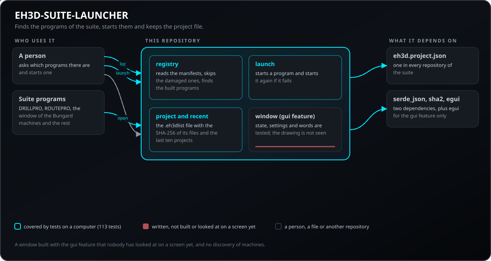
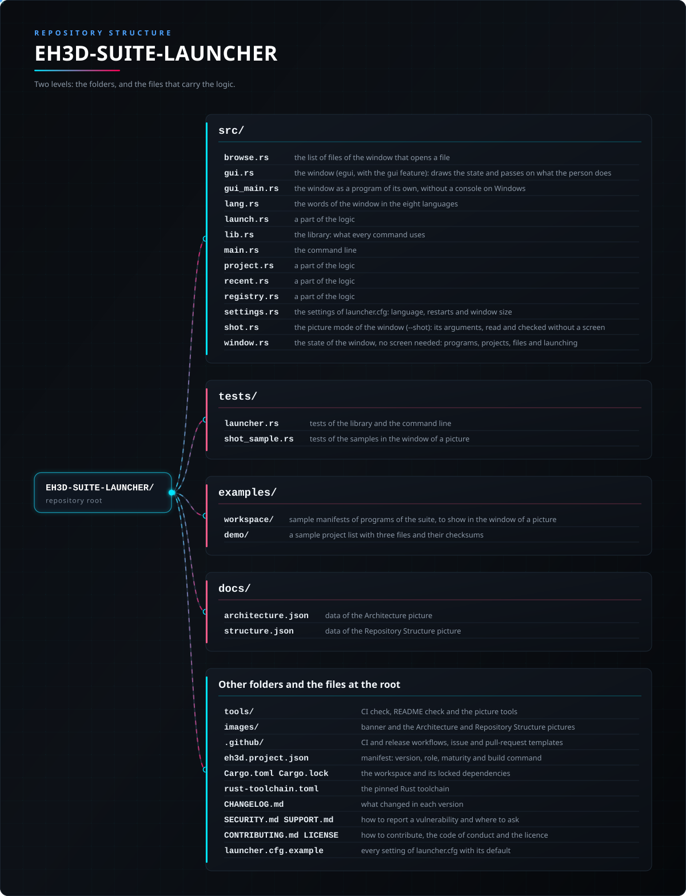

<p align="center">
  
</p>

# 📖 EH3D-SUITE-LAUNCHER

<p align="center"><a href="README.md">🇺🇸 English</a> | <a href="README_spa.md">🇪🇸 Español</a> | <a href="README_fra.md">🇫🇷 Français</a> | <a href="README_ita.md">🇮🇹 Italiano</a> | <a href="README_deu.md">🇩🇪 Deutsch</a> | <a href="README_zho.md">🇨🇳 中文</a> | 🇯🇵 <b>日本語</b> | <a href="README_por.md">🇵🇹 Português</a></p>

### EH3D Fabrication Suite のハブ：プログラムを見つけて起動し、プロジェクト ファイルを管理

<p align="center">
  
  
  
  
  
</p>

---

**正直さの確認 - 現在実際に動くもの：** Rust ライブラリとコマンドライン プログラム（`eh3d-launcher`）で、コンピューター上で実行される 119 件のテストがあります：マニフェストからスイートのプログラムを見つけて起動し、失敗したら再起動し、最近のプロジェクトを保持し、各ファイルの SHA-256 付きでプロジェクト ファイルを書き込み・検証します。ウィンドウ（`eh3d-launcher-gui`、`gui` 機能でビルド）は書かれ、そのロジックはテスト済みですが、ビルドも画面での確認もしていません。機械では何も試しておらず、実際のファイルの集まりでも確認していません。

---

> **安全とセキュリティの状況：** このプログラムは機械を制御せず、安全システムでもありません。出力は、機械で何かを実行する前に人が確認する必要があります。ここにあるものは実機で動かしたことがありません。


## 📋 ひと目で

| | |
|---|---|
| バージョン | `0.0.5` |
| 成熟度 | 足場 |
| テスト | 119 |
| 技術スタック | Rust |
| 実機での動作 | 未試験：ここにあるものは機械で動かしたことがありません |

**移動先：** [概要](#-概要) · [アーキテクチャ](#-アーキテクチャ) · [クイックスタート](#-クイックスタート) · [テスト](#-テスト) · [構成](#-リポジトリの構成) · [関連](#-関連プロジェクト)

## 🚦 プロジェクトの状況

各行はこのリポジトリの一部分で、信号は今日どこまで進んでいるかを示します。計画ではなく、リポジトリが示せるもの（テスト、ビルド、実行）に基づいて書かれています。

🟢 完了・検証済み · 🟡 動作する（既知の制限あり） · 🟠 一部のみ、または未検証 · 🔴 未実装または動作しない

| 領域 | 状態 | ここでの意味 |
|---|---|---|
| コア | 🟡 | マニフェストからスイートのプログラムを見つけて起動し、失敗したら再起動し、最近のプロジェクトを保持し、各ファイルの SHA-256 付きでプロジェクト ファイルを書き込み・検証します。コンピューター上で通常入力と破損入力でテスト済み。実際のファイルの集まりでは未確認。 |
| コマンドライン | 🟡 | `eh3d-launcher` はライブラリと同じ関数を実行して結果を表示します。エラーはメッセージと 0 以外の終了コードで返ります。 |
| テスト | 🟡 | 119 件のテストが通ります（`cargo test`）。通常ケース、境界ケース、破損入力を含みます。 |
| セキュリティ | 🟡 | 安全な Rust のみ（`forbid(unsafe_code)`）。受け取ったファイルでパニックせず、不正な値は理由付きのエラーになります。独立したレビューはありません。 |
| ウィンドウ | 🟠 | 作成済み（egui、`--features gui`、プログラム `eh3d-launcher-gui`）：最近のプロジェクト、プロジェクトを開く／作成する、コマンドラインと同じ検証でファイルを追加・削除する、スイートのプログラムを一覧しボタンで起動する。ロジックはテスト済みですが、まだビルドも画面での確認もしていません。 |
| 実機 | 🔴 | 未試験：ここにあるものは機械で実行したことがありません。 |
| ドキュメント | 🟡 | 8 言語の README、変更履歴、`docs/` から描いた 2 枚の図。 |

## 🎯 概要

* **レジストリ**（`src/registry.rs`）：スイートの各リポジトリは `eh3d.project.json` で自分が何かを示します。ランチャーはそれを読み、壊れたものは理由付きで飛ばし、ビルド済みのプログラムを知らせます。
* **ランチャー**（`src/launch.rs`）：スイートのプログラムを起動し、エラーで終了したら待ち時間を倍にしながら最大 2 回再起動します。正常終了したプログラムはそのままにします。
* **プロジェクト ファイル**（`src/project.rs`、`.eh3dlist`）：名前、ジョブのファイル（種類と SHA-256）、作業ゼロ。読み込み時にプロジェクト外に出るパスを拒否し、最初の形式を移行します。**最近のプロジェクト**（`src/recent.rs`）は直近 10 件を保持します。
* **検索と再起動：** プログラムのバイナリは `Cargo.toml` の `[[bin]]` 名（`eh3d-camdebug`、`eh3d-pnp` など）で見つかります。オペレーターが意図して終了した（シグナル）プログラムや、引数を拒否した（終了コード 1 または 2）プログラムは再起動されず、クラッシュした場合だけ再起動されます。
* **ウィンドウ**（`src/window.rs`、`src/gui.rs`；`--features gui`、プログラム `eh3d-launcher-gui`）：最近のプロジェクト、プロジェクトを開く／作成する、`add-layer` と同じ検証でファイルを追加・削除する、スイートのプログラムをプロジェクト付きでボタンから起動する。状態、操作、設定、文言はテスト付きの単純なコードで、描画は薄い層です。作成済みですが、まだ画面では確認していません。

## 🧩 EH3D での役割

EH3D-SUITE-LAUNCHER は EH3D Fabrication Suite のプログラムの一つです。ライブラリ、コマンドライン、そして `gui` 機能でビルドするとスイートの他のプログラムと共通の外観のウィンドウ（`eh3d-launcher-gui`）として動作します。単純なファイルを読み書きするため、単独でも他のプログラムの間でも使えます。

## 🏛️ アーキテクチャ

<p align="center">
  
</p>


このリポジトリの各部分の関係：誰が使い、何を持ち、何に依存するか。図は `docs/architecture.json` から描かれ、コードと照合されます。

## ✨ 機能

* **ライブラリとコマンドライン：** `eh3d-launcher` の各コマンドはライブラリの関数なので、スイートの他のプログラムがプロセスを起動せずに呼び出せます。
* **破損入力のテスト：** 空のファイル、ゴミデータ、巨大な数値、途中で切れたファイルも与え、どれもパニックしてはいけません。
* **推測しない：** 意味のない値は、どの値かと理由を示すエラーになり、見かけだけ正しい結果にはなりません。
* **読み込むファイルのサイズ上限：** リポジトリのマニフェストと最近のプロジェクトの一覧は、コマンドラインでもウィンドウでも `launcher.cfg` の `max_file_mib`（既定は 16 MiB、1 から 1024）以下のときだけ読み込まれ、`launcher.cfg` 自体は 1 MiB までです。大きすぎるマニフェストは、他の壊れたマニフェストと同じようにコード `file_too_large` と名前付きでスキップされ、一覧が大きすぎる場合 `eh3d-launcher recent` はそのコードで終了し、ウィンドウは空の一覧で起動します。他のコードは `file_unreadable` と `file_not_text` です。
* **unsafe コードなし：** ライブラリとプログラムに `#![forbid(unsafe_code)]`。
* **より安全な一覧とプロジェクト：** レイヤーのパスには `.`、Windows が受け付けない名前（`CON`、`AUX`、`COM1` など）、末尾のドットや空白を使えず、大文字小文字だけが違う 2 つのレイヤーは 1 つとして扱い、最近の一覧は存在するファイルのフルパスを保持し、同時に実行した 2 つの処理（`recent`、`add-layer`）は変更中ファイルをロックするので互いの変更を失わず、レイヤーは 64 KiB のブロックでハッシュ化し、シグナルで終了したプログラムは失敗ではなくそのとおりに知らせます。

## 🔒 セキュリティと安全

| 脅威 | 対策 |
|---|---|
| 破損・途中切れ・空のファイル | パニックなし：テストは有効な入力をあらゆる位置で切り、ゴミデータも与えます |
| 意味のない数値（負、無限、極端に大きい） | 値を示すエラーで拒否され、もっともらしい値に丸められることはありません |
| 安全でないメモリ使用 | `forbid(unsafe_code)` の安全な Rust のみ |

**防御していないこと：** エラーなく作られた結果は、検証された結果ではありません。ここには機械の限界を知るものはなく、プログラムは独立したレビューを受けていません。脆弱性は非公開で報告してください（[SECURITY.md](SECURITY.md) 参照）。

## 🔌 インターフェース

ライブラリは `eh3d_suite_launcher`（`use eh3d_suite_launcher::...`）、コマンドラインは `eh3d-launcher` です。コマンドは次のとおりで、結果は標準出力に表示され、エラーは標準エラー出力に 0 以外の終了コードで報告されます。ネットワークアクセスはありません。

```text
EH3D-SUITE-LAUNCHER/
├── src/
│   ├── browse.rs                                ファイルを開くウィンドウのファイル一覧
│   ├── gui.rs                                   ウィンドウ（egui、gui 機能）：状態を描き、操作を伝える
│   ├── gui_main.rs                              独立したウィンドウ用プログラム（Windows ではコンソールなし）
│   ├── lang.rs                                  ウィンドウの文言（8言語）
│   ├── launch.rs                                ロジックの一部
│   ├── limit.rs                                 サイズ上限付きの読み込みと拒否ごとのコード
│   ├── lib.rs                                   ライブラリ：各コマンドが使うもの
│   ├── main.rs                                  コマンドライン
│   ├── project.rs                               ロジックの一部
│   ├── recent.rs                                ロジックの一部
│   ├── registry.rs                              ロジックの一部
│   ├── settings.rs                              launcher.cfg の設定：言語、再起動、ウィンドウサイズ
│   ├── shot.rs                                  ウィンドウの画像モード（--shot）：画面なしで読み取り・検証される引数
│   └── window.rs                                画面なしのウィンドウの状態：プログラム、プロジェクト、ファイル、起動
├── tests/
│   ├── launcher.rs                              ライブラリとコマンドラインのテスト
│   ├── read_limit.rs                            読み込むファイルのサイズ上限のテスト
│   └── shot_sample.rs                           画像用ウィンドウでのサンプルのテスト
├── examples/
│   ├── workspace/                               スイートのプログラムのサンプルマニフェスト（画像用ウィンドウで表示）
│   └── demo/                                    3つのファイルとそのチェックサムを含むサンプルのプロジェクト一覧
├── docs/
│   ├── architecture.json                        アーキテクチャ図のデータ
│   └── structure.json                           構成図のデータ
├── tools/                                       CI と README のチェック、図のツール
├── images/                                      バナーとアーキテクチャ・リポジトリ構成の図
├── .github/                                     CI とリリースのワークフロー、Issue と PR のテンプレート
├── eh3d.project.json                            マニフェスト：バージョン、役割、成熟度、ビルドコマンド
├── Cargo.toml Cargo.lock                        ワークスペースと固定された依存関係
├── rust-toolchain.toml                          固定されたRustツールチェーン
├── CHANGELOG.md                                 各バージョンの変更点
├── SECURITY.md SUPPORT.md                       脆弱性の報告方法と問い合わせ先
├── CONTRIBUTING.md CODE_OF_CONDUCT.md LICENSE   貢献方法、行動規範、ライセンス
└── launcher.cfg.example                         launcher.cfg のすべての設定と既定値
```

## ⚙️ 設定

設定ファイルはランチャーのフォルダにある `launcher.cfg` で、`launch` とウィンドウが読みます。その `workspace = フルパス` の行がプログラムを起動するフォルダです（起動するのはスイートの既知のプログラムのみ）。任意の行 `language`、`max_restarts`、`backoff_ms`、`window_width`、`window_height` で、ウィンドウの言語、クラッシュしたプログラムを再起動する回数、待ち時間、ウィンドウの大きさを指定します。`launcher.cfg.example` にすべてのキーと既定値、上限を載せています。それ以外は、選択は（インターフェースを参照）コマンドラインの引数で渡し、各既定値はコマンドのヘルプ（`eh3d-launcher help`）に書かれています。値の上限はコード内の名前付き定数で、テストで確認されています。

## 🚀 クイックスタート

安定版の Rust ツールチェーン（1.95 以降）が必要です。

```bash
cargo build --release
cargo test
cargo run --release -- list --workspace ..
# ウィンドウ（gui 機能が必要）
cargo build --release --features gui
cargo run --release --features gui --bin eh3d-launcher-gui
cargo run --release --features gui --bin eh3d-launcher-gui -- --shot screen.png --open examples/workspace --open examples/demo/demo.eh3dlist   # a picture of the window
```

手動で開かずにウィンドウの画像を撮るには、`--shot FILE.png` を付けて実行します（`--size WxH`, `--theme forge|dark|light`, `--wait N`, `--lang CODE`, `--open FILE`, `--replace` も使えます）。指定のサイズで開き、PNG を保存し、設定は保持せず、自動で閉じます（終了コードは、ファイルを書き込めたら 0、書けなければ 1、引数が誤りなら 2）。

## 🧪 テスト

テストは 119 件あります（`cargo test`、CI では Windows と Linux で実行）。通常ケース、境界ケース、破損入力を確認し、空のファイル、ゴミデータ、途中で切れたファイルでもパニックしません。CI は `cargo fmt --check`、警告をエラーにした `cargo clippy` （`--features gui` でも）、`python -I tools/ci_validate.py` も実行します。

## 🏗️ ビルドとリリース

バージョンは `Cargo.toml` と `eh3d.project.json` にあり、各バージョンは [CHANGELOG.md](CHANGELOG.md) に項目があります。`build.bat` / `build.sh` でビルド、`test.bat` / `test.sh` でテスト、`run.bat` / `run.sh` でサンプル実行します。リリースは GitHub で公開されます。

### ダウンロード

各リリースには、Windows（64 ビットと 32 ビット）、Linux（64 ビット）、macOS（Apple silicon と Intel）向けのコマンドライン プログラムとウィンドウが、`<名前>-<バージョン>-<システム>.zip`（Windows）または `.tar.gz` として含まれ、2 つのプログラム、ライセンス、readme、アイコン、`launcher.cfg.example` が入っています。ファイルは GitHub Actions でビルドされ、`SHA256SUMS` に記載されます。ダウンロードを確認するには、隣の `.sha256` ファイルとハッシュを比較してください（`sha256sum -c`）。

## 📂 リポジトリの構成

<p align="center">
  
</p>

<details>
<summary>ツリーのテキスト版</summary>

```text
EH3D-SUITE-LAUNCHER/
├── src/
│   ├── browse.rs                                ファイルを開くウィンドウのファイル一覧
│   ├── gui.rs                                   ウィンドウ（egui、gui 機能）：状態を描き、操作を伝える
│   ├── gui_main.rs                              独立したウィンドウ用プログラム（Windows ではコンソールなし）
│   ├── lang.rs                                  ウィンドウの文言（8言語）
│   ├── launch.rs                                ロジックの一部
│   ├── lib.rs                                   ライブラリ：各コマンドが使うもの
│   ├── main.rs                                  コマンドライン
│   ├── project.rs                               ロジックの一部
│   ├── recent.rs                                ロジックの一部
│   ├── registry.rs                              ロジックの一部
│   ├── settings.rs                              launcher.cfg の設定：言語、再起動、ウィンドウサイズ
│   ├── shot.rs                                  ウィンドウの画像モード（--shot）：画面なしで読み取り・検証される引数
│   └── window.rs                                画面なしのウィンドウの状態：プログラム、プロジェクト、ファイル、起動
├── tests/
│   ├── launcher.rs                              ライブラリとコマンドラインのテスト
│   └── shot_sample.rs                           画像用ウィンドウでのサンプルのテスト
├── examples/
│   ├── workspace/                               スイートのプログラムのサンプルマニフェスト（画像用ウィンドウで表示）
│   └── demo/                                    3つのファイルとそのチェックサムを含むサンプルのプロジェクト一覧
├── docs/
│   ├── architecture.json                        アーキテクチャ図のデータ
│   └── structure.json                           構成図のデータ
├── tools/                                       CI と README のチェック、図のツール
├── images/                                      バナーとアーキテクチャ・リポジトリ構成の図
├── .github/                                     CI とリリースのワークフロー、Issue と PR のテンプレート
├── eh3d.project.json                            マニフェスト：バージョン、役割、成熟度、ビルドコマンド
├── Cargo.toml Cargo.lock                        ワークスペースと固定された依存関係
├── rust-toolchain.toml                          固定されたRustツールチェーン
├── CHANGELOG.md                                 各バージョンの変更点
├── SECURITY.md SUPPORT.md                       脆弱性の報告方法と問い合わせ先
├── CONTRIBUTING.md CODE_OF_CONDUCT.md LICENSE   貢献方法、行動規範、ライセンス
└── launcher.cfg.example                         launcher.cfg のすべての設定と既定値
```

</details>

## 🗺️ ロードマップと既知の制限

**現時点で分かっている制限**

* ウィンドウは書かれロジックはテスト済みですが、まだビルドも画面での確認もしていません。
* 機械でも実際のファイルの集まりでも試しておらず、独立したレビューも受けていません。
* ネットワーク上の機械はまだ検出せず、スイートの更新も行わず（EH3D-UPDATER の役目）、`.eh3dlist` はファイルを指す JSON で、ファイルを含むアーカイブではありません。

**次のステップ**

* ネットワーク上の工房の機械を検出し、ウィンドウから EH3D-UPDATER を呼び出す。
* 各システムの画面でウィンドウを確認し、見つかった点を調整する。
* 実際のファイルとスイートの他のプログラムで試す。

## 🌍 言語

README とテキストは、英語、スペイン語、フランス語、イタリア語、ドイツ語、中国語、日本語、ヨーロッパポルトガル語で提供されています。

## 🔗 関連プロジェクト

* [EH3D-COMMON](https://github.com/JuanenRac/EH3D-COMMON): プロジェクト コンテナーとスイート共通の型
* [EH3D-UPDATER](https://github.com/JuanenRac/EH3D-UPDATER): スイートのアップデーター
* [EH3D-DRILLPRO](https://github.com/JuanenRac/EH3D-DRILLPRO): 穴あけプログラム
* [EH3D-ROUTEPRO](https://github.com/JuanenRac/EH3D-ROUTEPRO): 輪郭ミリング プログラム
* [EH3D-BUNGARD-GUI](https://github.com/JuanenRac/EH3D-BUNGARD-GUI): Bungard 機械のウィンドウ
* [EH3D-PHOENIX-CNC](https://github.com/JuanenRac/EH3D-PHOENIX-CNC): 機械制御プログラム

## 📚 ドキュメント

* [変更履歴](CHANGELOG.md)
* [アーキテクチャと構成のデータ](docs/architecture.json)：2 枚の図を描くためのデータ。

## 🤝 コントリビュートとコミュニティ

* プルリクエストの前に `cargo fmt --check`、`cargo clippy --all-targets -- -D warnings`、`cargo test`、`python -I tools/ci_validate.py` を実行し、すべて通してください。[CONTRIBUTING.md](CONTRIBUTING.md) と[行動規範](CODE_OF_CONDUCT.md)を参照。
* README は 8 言語あります。文章の変更は 8 ファイルすべてで行い、2 枚の図は `tools/make_architecture.py` と `tools/make_structure.py` が `docs/architecture.json` と `docs/structure.json` から描きます。
* 脆弱性は非公開で報告してください：[SECURITY.md](SECURITY.md)。質問・提案・報告：electrohobby3d@gmail.com（[SUPPORT.md](SUPPORT.md)）。

## 👤 作者

**JuanenRac (Electro Hobby 3D)** · electrohobby3d@gmail.com

## 📜 ライセンス

ソフトウェア：GPL-3.0-or-later。[LICENSE](LICENSE) を参照。スイートのハードウェア設計には CERN OHL-S を使います。
